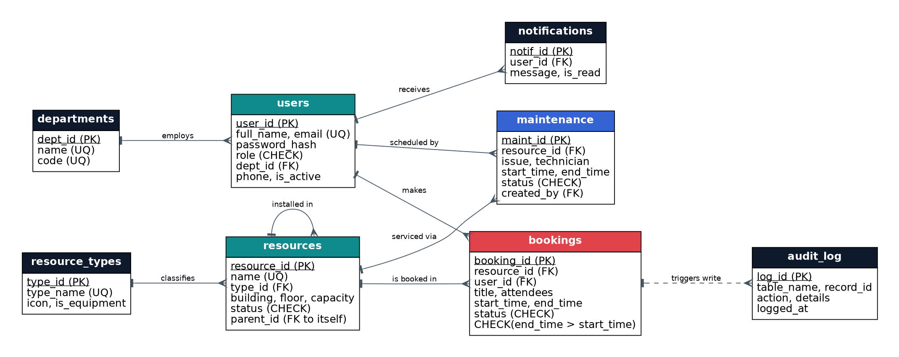

# Smart Campus Resource Manager

A booking system for classrooms, labs, seminar halls and equipment where **the database itself refuses to double-book anything**.

   

Most booking apps check for clashes in application code, which breaks the moment two requests arrive together or someone writes to the database directly. I wanted to see how far I could push that responsibility down into the database, so the rules hold no matter who is writing: the web app, the CLI, or a raw SQL console.

It comes with a web interface and an interactive terminal app, both running on the same service layer and the same SQLite database.

---

## Features

- **Conflict-proof bookings.** A trigger rejects any booking that overlaps another one on the same resource, even from raw SQL.
- **Smart suggestions.** When a slot is taken, the app proposes free time slots on the same resource and other free rooms of the same type.
- **Approval workflow.** Student and staff requests stay pending (and hold the slot) until an admin approves. Faculty and admin bookings are approved instantly.
- **Maintenance handling.** Scheduling maintenance automatically cancels clashing bookings and notifies the affected users.
- **Notifications and audit trail.** Triggers write every change to an audit log and tell users when a booking is approved, rejected or cancelled.
- **Reports.** Utilisation hours, peak booking hours, department usage, most active users and never-used resources.
- **Web app and CLI.** Pick whichever you like; both share the same business logic.

## Tech stack

| Part | Technology |
|---|---|
| Database | SQLite (constraints, indexes, views, triggers, transactions) |
| Backend | Python 3, Flask REST API |
| Frontend | HTML, CSS, vanilla JavaScript (no build step) |
| CLI | Python, interactive menus |
| Tests | `unittest` |

---

## Getting started

```bash
git clone https://github.com/<your-username>/smart-campus-resource-manager.git
cd smart-campus-resource-manager
pip install -r requirements.txt
```

**Web app**
```bash
python app.py
# open http://127.0.0.1:5000
```

**Terminal app**
```bash
python cli.py
```

The database and demo data are created automatically on first run. To reset it:
```bash
python cli.py seed
```

Use `python3` instead of `python` on macOS and Linux.

### Demo accounts

| Role | Email | Password |
|---|---|---|
| Admin | admin@campus.edu | admin123 |
| Faculty | meera.rao@campus.edu | faculty123 |
| Staff | kavita@campus.edu | staff123 |
| Student | rahul@campus.edu | student123 |

You can also register a new account from either interface.

---

## Using it

### Web app
1. Log in (or register) and open **Book a resource**.
2. Choose a date and time. Every resource is shown as **free** or **busy**, with the reason.
3. Pick one, add a title and confirm.
4. Try booking an overlapping time. You get a clear error plus one-click alternatives.
5. As an admin, approve requests under **All bookings**, schedule servicing under **Maintenance**, and check **Reports** and the **Audit log**.

### Terminal app
```
1. Login    2. Register new user    3. Exit
```
After login you get a numbered menu: dashboard, browse resources, find available resources, book, my bookings, cancel, day schedule (with a text timeline) and notifications. Admins also get approvals, add resource, change status, maintenance, reports, audit log and users.

The last admin menu item, **DBMS concepts live demo**, runs ten short experiments against the real database and prints the SQL for each one:

1. Listing schema objects (tables, views, indexes, triggers)
2. A join through a view
3. `GROUP BY` with `HAVING`
4. A correlated `NOT EXISTS` subquery
5. A self join
6. A raw-SQL double booking rejected by the trigger, plus `CHECK` and capacity errors
7. A transaction rolled back
8. The query plan using the composite index
9. Ten threads booking the same slot at once
10. The audit trail written by triggers

Everything the demo writes is rolled back or removed afterwards.

---

## How conflict detection works

Two bookings on the same resource overlap when:

```
existing.start_time < new.end_time  AND  existing.end_time > new.start_time
```

That condition lives in a `BEFORE INSERT` trigger (and a matching `BEFORE UPDATE` trigger for approvals):

```sql
CREATE TRIGGER trg_booking_before_insert
BEFORE INSERT ON bookings
BEGIN
    SELECT RAISE(ABORT, 'CONFLICT: Resource is already booked during this time slot.')
    WHERE NEW.status IN ('pending','approved')
      AND EXISTS (SELECT 1 FROM bookings b
                  WHERE b.resource_id = NEW.resource_id
                    AND b.status IN ('pending','approved')
                    AND b.start_time < NEW.end_time
                    AND b.end_time   > NEW.start_time);
END;
```

Back-to-back bookings (10:00–11:00 and 11:00–12:00) are allowed. The same trigger also checks capacity, maintenance windows and out-of-service resources.

**Concurrency.** Every write runs inside `BEGIN IMMEDIATE`, which takes SQLite's write lock before the overlap check. Two simultaneous requests are therefore serialised, and the second one always sees the first. The test suite fires 10 threads at one slot and asserts that exactly one wins.

---

## Database design



| Table | Purpose |
|---|---|
| `departments` | Departments, with unique name and code |
| `users` | Accounts with role (`admin`, `faculty`, `staff`, `student`) |
| `resource_types` | Classroom, Laboratory, Seminar Hall, Conference Room, Equipment |
| `resources` | Every bookable thing; `parent_id` is a self-referencing key (equipment installed in a room) |
| `bookings` | Reservations, with `CHECK (end_time > start_time)` and a date-format check |
| `maintenance` | Servicing windows |
| `notifications` | Messages to users |
| `audit_log` | History written by triggers |

The schema is in 3NF. Lookup data (departments, resource types) lives in its own tables, every non-key column depends on the key, and the audit log and notifications are deliberately denormalised because history must not change when source rows do.

**Also in `schema.sql`:** 6 indexes (including a composite `bookings(resource_id, start_time, end_time)` for the overlap check), 2 views (`v_booking_details`, `v_resource_utilization`) and 11 triggers (conflict checks, maintenance cascade, audit and notifications).

### Database concepts used

| Concept | Where |
|---|---|
| Primary, foreign and self-referencing keys | All tables, `resources.parent_id` |
| Constraints | `NOT NULL`, `UNIQUE`, `CHECK` for roles, statuses, time order, capacity and date format |
| Triggers | Conflict prevention, maintenance cascade, audit log, notifications |
| Transactions and ACID | `BEGIN IMMEDIATE` / `COMMIT` / `ROLLBACK` helper in `db.py` |
| Indexing | Composite index for overlap lookups |
| Views | Booking details (multi-table join), resource utilisation (aggregates) |
| Joins and subqueries | Inner, left and self joins; `NOT EXISTS` and `NOT IN` |
| Aggregation | `COUNT`, `SUM`, `GROUP BY`, `HAVING` in reports |
| Set operations | `UNION ALL` to merge bookings and maintenance when finding free gaps |
| Security | Salted PBKDF2-SHA256 hashes, parameterised queries, role-based access |

---

## Business rules

- Campus hours are 07:00 to 22:00.
- A booking must start and end on the same day, last between 15 minutes and 12 hours, and not be in the past.
- Attendees cannot exceed capacity.
- No overlap with another pending or approved booking, or with a maintenance window.
- Resources under maintenance or retired cannot be booked.
- Pending requests whose start time passes expire automatically; finished bookings are marked completed.
- Only admins approve or reject. Users can cancel only their own bookings.

---

## Project structure

```
.
├── app.py              Flask REST API, also serves the frontend
├── cli.py              Interactive terminal app
├── services.py         Business logic shared by web and CLI
├── db.py               Connections and the transaction helper
├── schema.sql          Tables, constraints, indexes, views, triggers
├── seed.py             Demo data generator
├── dbms_demo.py        The live demo behind the CLI's last menu item
├── tests.py            Automated tests
├── requirements.txt
├── static/             index.html, style.css, app.js
└── docs/
    ├── ER_Diagram.png
    ├── demo_queries.sql
    └── run_demo_queries.py
```

**Flow:** browser or CLI → Flask routes / menus → `services.py` → SQLite.

## API overview

| Method | Endpoint | Description |
|---|---|---|
| POST | `/api/register`, `/api/login`, `/api/logout` | Authentication (session cookie) |
| GET | `/api/me`, `/api/meta` | Current user, departments and types |
| GET / POST | `/api/resources` | Search and list; add (admin) |
| PUT / DELETE | `/api/resources/<id>` | Edit or retire; delete (admin) |
| GET | `/api/resources/<id>/schedule?date=` | Day schedule |
| GET | `/api/availability?start=&end=&type_id=` | Free or busy for every resource |
| GET / POST | `/api/bookings` | List and create |
| POST | `/api/bookings/<id>/status` | Approve, reject or cancel |
| GET / POST | `/api/maintenance` | Maintenance windows (admin writes) |
| GET | `/api/dashboard`, `/api/reports`, `/api/audit`, `/api/users` | Insights (reports, audit, users are admin only) |
| GET / POST | `/api/notifications` | Inbox |

---

## Tests

```bash
python tests.py
```

Eight tests run against a temporary database and cover: registration and login rules, overlap rejection (and back-to-back bookings being allowed), the trigger firing on raw SQL, capacity and `CHECK` constraints, the maintenance cascade with notifications, approval workflow and role permissions, the 10-thread concurrency race, and reports and audit output.

To run the demo queries against your own database:
```bash
python docs/run_demo_queries.py
```
The two statements shown as rejected are meant to fail; they demonstrate the trigger and a `CHECK` constraint.

Built by [Vishwani](https://github.com/Vishwani7002). 
Feedback and ideas are welcome, so feel free to open an issue.
