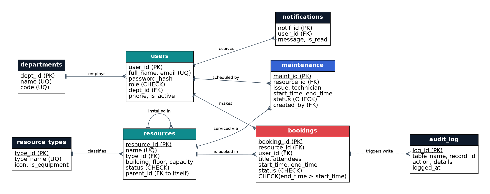

# 🏛️ Smart Campus Resource Allocation & Conflict Management System

A full-stack, database-driven system to **reserve and manage classrooms, laboratories, seminar halls and equipment** – while the **database itself detects and prevents scheduling conflicts**.

| Layer | Technology |
|---|---|
| Database | **SQLite** (tables, constraints, indexes, views, triggers, transactions) |
| Backend | **Python 3 + Flask** REST API, shared service layer |
| Frontend | HTML5 + CSS3 + vanilla JavaScript single-page app (no build step) |
| CLI | Interactive terminal application (same business logic as the web app) |

---

## 1. Quick start

```bash
# 1. Install Python 3.9+  (check with: python --version)
# 2. Open a terminal inside the project folder
pip install -r requirements.txt        # installs Flask (only dependency)

# ---- Web application ----
python app.py                          # first run auto-creates campus.db + demo data
# open  http://127.0.0.1:5000

# ---- Command-line application ----
python cli.py                          # interactive menus
python cli.py seed                     # reset database with fresh demo data
python cli.py initdb                   # empty database (schema only)
```

> Windows: use `python`; macOS/Linux: use `python3`.
> The very first run creates the database automatically, so there is nothing else to install or configure.

### Demo accounts
| Role | Email | Password |
|---|---|---|
| Administrator | admin@campus.edu | admin123 |
| Faculty | meera.rao@campus.edu | faculty123 |
| Staff | kavita@campus.edu | staff123 |
| Student | rahul@campus.edu | student123 |

You can also click **Create account** to register a brand-new user (name, email, role, department, phone, password). New users are logged in immediately and can start booking.

---

## 2. How to operate the system

### As a student / staff / faculty
1. **Register or log in** (demo buttons fill credentials for you).
2. **Dashboard** – live stats: free resources, bookings today, your upcoming bookings.
3. **Resources** – search and filter classrooms, labs, halls, equipment. Click **Schedule** to see a resource's day.
4. **Book a resource** – choose date and time → the list instantly shows which resources are **free** or **busy (and why)** → pick one → add a title → **Confirm booking**.
   * Faculty and admin bookings are **approved instantly**; student and staff bookings are **pending** until an admin approves (the slot is held meanwhile, so nobody else can take it).
   * If you pick a busy slot the **database rejects it** and the app offers **free alternative times** and **other free rooms** of the same type – one click to switch.
5. **My bookings** – filter by status; cancel your own bookings.
6. 🔔 **Notifications** – you are told when a booking is approved, rejected or auto-cancelled.

### As an administrator
* **All bookings** – **Approve / Reject / Cancel** any request.
* **Resources → Add resource / Edit** – create rooms or equipment, change status (available / maintenance / retired). Taking a resource out of service auto-cancels its future bookings.
* **Maintenance → Schedule maintenance** – pick a resource and window; clashing bookings are cancelled automatically by a trigger and users are notified.
* **Reports** – utilisation hours, peak hours, department usage, most active users, never-used resources, conflicts blocked.
* **Audit log** – every insert / status change recorded by triggers.
* **Users** – see everyone, activate / deactivate accounts.

### CLI (terminal) walkthrough
```
python cli.py
 1. Login   2. Register new user   3. Exit
```
After logging in a numbered menu appears (Dashboard, Browse, Find available, Book, My bookings, Cancel, Day schedule with text timeline, Notifications; admins also get Approvals, Add resource, Maintenance, Reports, Audit log, Users). Booking in the CLI shows the same conflict messages and alternative suggestions.

---

### Run the tests / SQL demo
```bash
python tests.py                        # 8 automated tests (uses a temporary DB)
python docs/run_demo_queries.py        # shows SQL concepts + trigger rejections
```

---

## 3. Project structure
```
smart_campus/
├── app.py              Flask REST API + serves the frontend
├── cli.py              Command-line interface
├── services.py         Business logic (shared by web + CLI)
├── db.py               Connection + ACID transaction helpers
├── schema.sql          ★ Tables, constraints, indexes, views, triggers
├── seed.py             Demo data generator
├── tests.py            Automated tests (incl. concurrency test)
├── requirements.txt
├── static/             index.html · style.css · app.js  (frontend)
└── docs/
    ├── ER_Diagram.png          Entity-Relationship diagram
    ├── demo_queries.sql        SQL to demonstrate DBMS concepts live
    ├── run_demo_queries.py     Runs those queries (no sqlite3 CLI needed)
    └── PRESENTATION_GUIDE.md   Slides outline, demo script, viva Q&A
```
**Architecture:** `Browser / CLI  →  Flask routes (app.py) / menus (cli.py)  →  services.py  →  SQLite (schema.sql)`

---

## 4. Database design



| Table | Purpose | Key constraints |
|---|---|---|
| departments | Academic / admin departments | PK, UNIQUE name & code |
| users | Accounts (admin, faculty, staff, student) | UNIQUE email, CHECK role, FK dept |
| resource_types | Classroom, Laboratory, Seminar Hall, Conference Room, Equipment | UNIQUE name |
| resources | Every bookable thing | FK type, **self-referencing FK** `parent_id`, CHECK status, CHECK capacity ≥ 0 |
| bookings | Reservations | FKs, CHECK `end_time > start_time`, CHECK date format, CHECK status |
| maintenance | Repair / service windows | FK resource, CHECK `end_time > start_time` |
| notifications | Messages to users | FK user (ON DELETE CASCADE) |
| audit_log | Automatic change history | written only by triggers / system |

Normalisation: all tables are in **3NF** – no repeating groups, every non-key attribute depends on the key, and lookups (`departments`, `resource_types`) are separated to avoid redundancy.

---

## 5. Core DBMS concepts used (and where)

| # | Concept | Where it is used |
|---|---|---|
| 1 | **ER modelling & relational schema** | 8 tables, 1:N relationships, `docs/ER_Diagram.png` |
| 2 | **Normalisation (1NF–3NF)** | Separate departments / resource_types / users / resources / bookings |
| 3 | **Primary keys & Foreign keys** | All tables; `PRAGMA foreign_keys = ON`; ON DELETE RESTRICT / CASCADE / SET NULL |
| 4 | **Self-referencing foreign key** | `resources.parent_id` (equipment installed in a room) |
| 5 | **Domain & integrity constraints** | NOT NULL, UNIQUE, CHECK (roles, statuses, time order, date format via GLOB, capacity) |
| 6 | **Triggers – conflict prevention** | `trg_booking_before_insert`, `trg_booking_before_update`: overlap, capacity, maintenance & out-of-service checks using `RAISE(ABORT)` |
| 7 | **Triggers – cascading business rules** | `trg_maint_cascade_cancel` (auto-cancel clashing bookings), maintenance start/finish updates resource status |
| 8 | **Triggers – audit & notifications** | `trg_audit_*`, `trg_notify_booking` |
| 9 | **Interval-overlap algorithm** | `existing.start < new.end AND existing.end > new.start` |
| 10 | **Transactions & ACID** | `BEGIN IMMEDIATE … COMMIT/ROLLBACK` in `db.transaction()`; atomic, isolated bookings, rollback on error |
| 11 | **Concurrency control** | `BEGIN IMMEDIATE` takes the write lock first → two users can't insert overlapping bookings simultaneously (serialisable) |
| 12 | **Indexing** | `idx_bookings_resource_time (resource_id, start_time, end_time)` etc. speed overlap checks |
| 13 | **Views** | `v_booking_details` (4-table join), `v_resource_utilization` (aggregates) |
| 14 | **Joins** | INNER, LEFT, SELF join across many queries |
| 15 | **Aggregation** | COUNT, SUM, ROUND, GROUP BY, HAVING (reports) |
| 16 | **Subqueries** | Correlated `NOT EXISTS` (availability), `NOT IN` (never-used resources), scalar subqueries in triggers |
| 17 | **Set operation** | `UNION ALL` to merge bookings + maintenance when finding free slots |
| 18 | **Security** | Salted PBKDF2-SHA256 password hashes, parameterised queries (SQL-injection safe), role-based access (RBAC), HTML escaping in UI |
| 19 | **Referential actions** | Retire (not delete) resources with history; FK prevents orphan rows |
| 20 | **Audit trail / logging** | `audit_log` populated by triggers, including blocked conflict attempts |

### The conflict-detection rule (explain this in the viva)
Two bookings on the same resource **overlap** when
`existing.start_time < new.end_time  AND  existing.end_time > new.start_time`.
This runs inside a **BEFORE INSERT trigger** – so even a direct SQL insert, a bug in the app, or two simultaneous users cannot create a double booking. The app layer adds friendly messages and alternative suggestions on top of the database guarantee.

---

## 6. REST API (summary)
| Method | Endpoint | Description |
|---|---|---|
| POST | /api/register · /api/login · /api/logout | Authentication (session cookie) |
| GET | /api/me · /api/meta | Current user · departments & types |
| GET/POST | /api/resources | List/search · add (admin) |
| PUT/DELETE | /api/resources/<id> | Edit/retire · delete (admin) |
| GET | /api/resources/<id>/schedule?date= | Day schedule |
| GET | /api/availability?start=&end=&type_id= | Free/busy for all resources |
| GET/POST | /api/bookings | List · create |
| POST | /api/bookings/<id>/status | approve / reject / cancel |
| GET/POST | /api/maintenance (+ /<id>/status) | Maintenance (admin writes) |
| GET | /api/dashboard · /api/reports · /api/audit · /api/users | Insights (reports, audit, users: admin) |
| GET/POST | /api/notifications (+ /read) | Inbox |

---

## 7. Business rules enforced
* Campus hours 07:00–22:00; booking must start & end on the same day; 15 min – 12 h; not in the past.
* Attendees ≤ resource capacity.
* No overlap with another pending/approved booking **or** a maintenance window.
* Resources under maintenance or retired cannot be booked.
* Only admins approve/reject; users may cancel only their own bookings.
* Pending requests whose start time passes are auto-expired; finished bookings auto-complete.

## 8. Troubleshooting
| Problem | Fix |
|---|---|
| `ModuleNotFoundError: flask` | `pip install -r requirements.txt` |
| Port 5000 busy | Edit `port=5000` at the bottom of `app.py` |
| Want fresh data | `python cli.py seed` (stop the web server first) |
| Fonts look plain offline | Cosmetic only – Google Fonts need internet |
